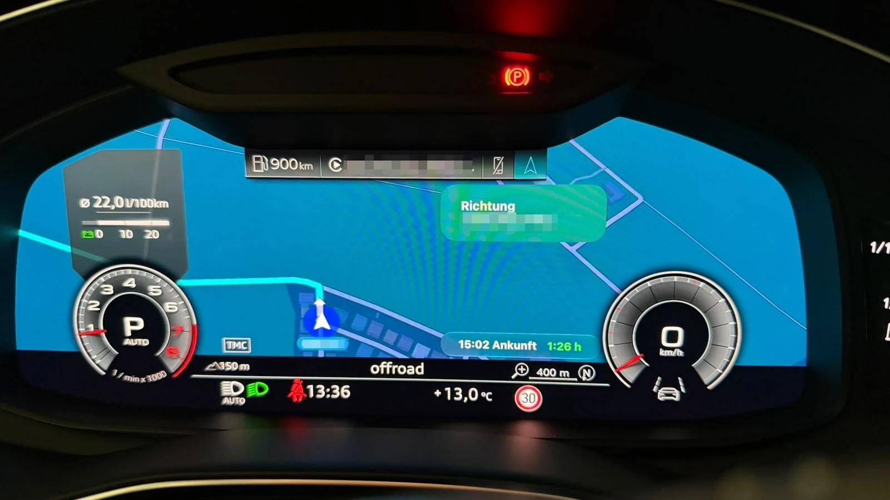

# CarPlay and Android Auto map in the Audi virtual cockpit (MH2p)

Puts the phone's own navigation map into the Audi virtual cockpit, in place of the Audi map: Google Maps, Apple Maps or Waze through CarPlay, and Google Maps through Android Auto. It is the map the phone lays out for a car's instrument cluster, with turn card, distances and arrival time, and not a copy of the MMI screen. Installed from one SD card, removed the same way.

*Google Maps through CarPlay in an Audi A6 C8.*

> **Status: beta.** For MMI software `MH2p_…_P2711` and `MH2p_…_P2873`. Use at your own risk.
>
> **Download:** [Releases](https://github.com/CrEaK/mh2p-cluster/releases) · **Guide:** [English](docs/carplay-cockpit/GUIDE-EN.md) · [Deutsch](docs/carplay-cockpit/ANLEITUNG.md) · **Questions and reports:** [Issues](https://github.com/CrEaK/mh2p-cluster/issues)

This project is built on [fifthBro/mh2p-cluster](https://github.com/fifthBro/mh2p-cluster), which brought Android Auto and CarPlay navigation to the instrument cluster on Porsche PCM5. See [Thanks](#thanks).

## What you get

- **CarPlay map in the cockpit**, wireless or by cable, in the large-map view and between the large gauges, in the layouts Classic, Dynamic and Performance.
- **Android Auto map in the cockpit** (by cable), Google Maps across the full width.
- **Zoom with the steering-wheel roller** (CarPlay: Google Maps and Apple Maps; Waze ignores it). Each cockpit view remembers its zoom.
- The map **stays in the cockpit** while the MMI shows the radio, the reverse camera or Audi menus (CarPlay).
- The map **follows day and night**.
- A **Smartphone Map** checkbox in the cockpit menu *Navigation* switches back to the Audi map.
- The Audi zoom scale and the traffic and satellite logos are hidden over the phone's map.
- LawPaul's NavCompassIgnore is included, so the cockpit does not switch to the compass when a route starts.

Optional, off until you switch it on in `settings.txt` (new in beta 5, software P2711 and P2873):

- **The phone's next turn in Audi's own box** next to the right dial (arrow, distance, street, arrival time), also in the cockpit tabs that show no map. With CarPlay and with Android Auto.
- **Arrow and distance on the head-up display.**
- **Audi's picture with the flag** for the last 200 m before the destination.

Also new in beta 5:

- **One settings file** on the card, `settings.txt`, in place of single switch files. Every value is explained in the file.
- The cockpit video uses a port Audi's firewall already passes. That closes a gap in which the map sometimes did not come after connecting.
- Switches for what the iPhone draws on the cockpit map (its turn card, its arrival line), and a fixed cockpit size for cars where the picture ends too early (Q3 with the Virtual Cockpit Plus).

## Tested vehicles

What people have reported so far. A tick means the map shows in the cockpit and was driven with.

| Car | MMI software | CarPlay map | Android Auto map | Reported by |
|---|---|---|---|---|
| A6 C8 | `MH2p_ER_AUG35_P2711` | ✓ wireless and by cable | ✓ | development car |
| A6 C8 2019 (US), head-up display | `MH2p_US_AUG35_P2711` | ✓ wireless | not reported | pbalazaar |
| A6 C8 | P2711 | not reported | ✓ | ImSundee |
| A6 C8 2020 | `MH2p_AS_AUG35_P2873` | ✓ wireless and by cable, all three layouts | not reported | brian06100227 |
| A6 C8 | `MH2p_ER_AUG35_P2873` | not reported | ✓, the picture smears at times ([#4](https://github.com/CrEaK/mh2p-cluster/issues/4)) | Lucain872 |
| S6 C8, head-up display | `MH2p_ER_AUG35_P2873` | ✓ | not reported | tester-02 |
| e-tron 55, 2020 (UK, right-hand drive) | `MH2p_ER_AUG35_P2711` | ✓ wireless | ✓ | ap-hyperbole |
| e-tron 2019 | `MH2p_AS_AUG35_P2711` | ✓ | not reported | holyglory0215 |
| e-tron 2020 | not stated | ✓ wireless, cards sit a little towards the middle ([#8](https://github.com/CrEaK/mh2p-cluster/issues/8)) | not reported | CrociStrike030 |
| Q8 2019 | not stated | ✓ | not reported | Eazyeric911 |
| Q8 2019, head-up display | P2711 | ✓ wireless | not reported | Alex1907 |
| Q3 with Virtual Cockpit Plus | P2711 | ✓ with a test package that sets the cockpit size ([#6](https://github.com/CrEaK/mh2p-cluster/issues/6)) | not reported | RayaneAm |
| Q7 | P2711 | not reported | ✓ | Bhushan Ahire |

Known not to work: a unit where another patch replaced the MMI's start program, so the SD ModKit cannot set up its part that runs at every boot ([#9](https://github.com/CrEaK/mh2p-cluster/issues/9)).

The optional parts have run on fewer cars: the turn box and the flag on the development A6 (P2711), the head-up display arrow on Alex1907's Q8 (P2711). On P2873 they are built from a dump of that software and have not been confirmed on a car yet.

**Your car is not in the list?** If it works, or does not, please open an [issue](https://github.com/CrEaK/mh2p-cluster/issues) with car, model year, MMI software version and phone, and it goes into this table. On other software versions than P2711 and P2873 CarPlay keeps working, but the cockpit keeps the Audi map: each version has to be checked against its own files first. If you want to help with yours, contact me through an issue.

## Install

Short version; the [guide](docs/carplay-cockpit/GUIDE-EN.md) has every step ([Deutsch](docs/carplay-cockpit/ANLEITUNG.md)).

1. Check the MMI software version under *Settings → System information → Version*. It must say `MH2p_…_P2711` or `MH2p_…_P2873`.
2. Download the zip of the latest [release](https://github.com/CrEaK/mh2p-cluster/releases) and unzip its **contents** onto an empty FAT32 SD card.
3. Ignition on, insert the card. The MMI restarts and installs. When it says it will restart normally and the screen goes black, pull the card out.
4. Connect the phone and start a route.
5. **Keep the card.** It holds the backups that are needed to uninstall.

The map works without any setting. For the turn box, the head-up display or other changes, see Options.

To update, unzip the new version over the same card and insert it again.

## Options

One file sets everything: copy `Mods/ClusterIntegration/settings.example.txt` on the card to `settings.txt`, remove the `#` in front of a line, set the value, and insert the card again. The file explains every value. The ones most people need:

| Line in `settings.txt` | What it does |
|---|---|
| `carplay_map=1` | The CarPlay map in the cockpit. On without the file; `0` turns it off. |
| `turn_box=1` | The phone's next turn in Audi's box next to the right dial (P2711, P2873). |
| `turn_box_on_map=0` | The box makes way while the cockpit shows the phone's map and stays in the other tabs. `1` shows it everywhere. |
| `hud_navigation=1` | Arrow and distance on the head-up display (P2711, P2873). |
| `destination_flag=1` | Audi's picture with the flag near the destination. |
| `map_turn_card=0`, `map_arrival_line=0` | Leave the cockpit map free of the iPhone's own turn card and arrival line, useful with the box. |
| `map_area_large=…`, `map_area_small=…` | Fit the picture when your cockpit hides part of the iPhone's cards. |

An update does not overwrite your `settings.txt`. The single files of earlier versions (`enable_carplay_altscreen.txt`, `altscreen_conf.txt`) keep working. Every setting and file: [docs/options.md](docs/options.md).

The turn box and the head-up display arrow put a small hook into Audi's navigation program. If the Audi navigation does not behave as before, set the lines back to `0` and insert the card again.

## Remove

- **Only the CarPlay map:** `carplay_map=0` in `settings.txt`, insert the card again.
- **Only the turn box or the head-up display:** set their lines to `0` (or take them out), insert the card again.
- **Everything:** create an empty file `uninstall.txt` in `Mods/ClusterIntegration` and insert the card again. NavCompassIgnore stays; an `uninstall.txt` in `Mods/NavCompassIgnore` removes it too.

## Reporting a problem

Open an [issue](https://github.com/CrEaK/mh2p-cluster/issues) with:

- car, model year and MMI software version
- phone and iOS or Android version, CarPlay wireless or by cable
- what happens, ideally with a photo
- the folder `Logs` from the card. The car copies its logs to the card whenever the card is inserted, so after a problem while driving insert it once more. Look through the files first: `ClusterIntegration.log` contains data about your MMI.

## Known limits

- Only P2711 and P2873 so far.
- The iPhone never reports its zoom back, the mod counts roller steps. If the zoom of a view is off, zoom once by hand and it is remembered again.
- Android Auto gets its layout once per connection, so one layout serves both cockpit views, and its cockpit map goes off while the MMI shows something else.
- Android Auto: the picture can smear on some cars ([#4](https://github.com/CrEaK/mh2p-cluster/issues/4)).
- If the CarPlay map does not come after connecting, reconnect, and please report it: beta 5 changes how the video reaches the car to close that gap.
- Android Auto has had less testing than CarPlay. Once, on leaving Android Auto, the MMI stayed black until the cable was pulled; it did not happen again. Please report it if you see it.
- Android Auto gives no arrival time, so the turn box shows arrow and distance only.
- The turn box, the head-up display arrow and the flag need the hook in the navigation program and so work on P2711 and P2873 only. On the head-up display of other versions only the street name appears.

## How it works, and more

- [docs/how-it-works.md](docs/how-it-works.md): the parts and how they fit together
- [docs/options.md](docs/options.md): every file on the card and every setting
- [docs/audi-notes.md](docs/audi-notes.md): the detailed technical record of the Audi work, car by car and date by date
- [docs/development.md](docs/development.md): building and testing
- [docs/porsche.md](docs/porsche.md): the original project's README for Porsche PCM5

## Thanks

**fifthBro** made this possible. [fifthBro/mh2p-cluster](https://github.com/fifthBro/mh2p-cluster) is the original project: the bridge from Android Auto and CarPlay navigation to the instrument cluster on Porsche PCM5, with its Java integration, the Android Auto hook, the CarPlay turn hook, the cluster video daemon and the installer. This fork runs on that code and those programs every day; the Audi work only adds to it. fifthBro's [mh2p-ssh-access](https://github.com/fifthBro/mh2p-ssh-access) is what made developing in the car practical. Thank you.

Also:

- **jonny190** for the Audi e-tron port this fork started from: the installer for the Audi unit's trimmed tool set, the stand-in class, the splash and cluster entry tools and the test harness. https://github.com/jonny190/mh2p-cluster
- **Bhushan Ahire (bhushangahire)** for the Audi Q7 profile: `KombiMapGuard`, the decoder ring-start and single-daemon fixes, and the cluster entry that reaches the phone. https://github.com/bhushangahire/mh2p-cluster
- **LawPaul** for the MH2p SD ModKit, which installs all of this, and for NavCompassIgnore; both are included unchanged. https://lawpaul.github.io/MH2p_SD_ModKit_Site/
- **luka-dev** for the protocol knowledge in mib2q-carplay-rgi and the QNX toolchain image. https://github.com/luka-dev/mib2q-carplay-rgi/
- **OneB1t** (Android Auto and VNC to MIB2 rendering, https://github.com/OneB1t/VcMOSTRenderMqb), **adi961** (turn-by-turn to the virtual cockpit, https://github.com/adi961/mib2-android-auto-vc) and **litdreams10** (platform knowledge, Android Auto testing), credited by the original project.
- **domihirtl** for one zoom per cockpit view.
- **Yasar** for the dumps from a P2873 unit. Without them that software version would not be supported.
- **Alex1907** for testing the head-up display over many rounds, with photos and logs each time.
- **Treuce** and **tearfalls1987** for testing and field notes on P2873.
- Everyone who tested, sent logs, photos and dumps: brian06100227, pbalazaar, ap-hyperbole, Eazyeric911, Lucain872, RayaneAm, tester-02, ImSundee, holyglory0215, CrociStrike030 and others.

The Audi A6 C8 work in this fork (CarPlay map video, the hand-back to the Audi map, steering-wheel zoom, cockpit layouts, the turn box and the head-up display arrow) is by [CrEaK](https://github.com/CrEaK).

## Licence

Free and not for sale. The project is under [CC BY-NC-SA 4.0](LICENSE.md), like the original. The parts written for this fork (`src/altscreen/`, `src/navhook/`, `nav/HudTurnFeed.java`) are GPL-3.0-or-later, as their file headers say.

*Not affiliated with Porsche, Volkswagen, Audi, Apple or Google.*
